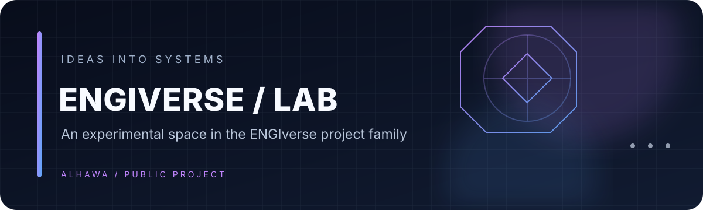

# ENGIvers · ENGIverse Lab

A companion repository in the ENGIverse project family.

This repository is currently a minimal starting point. Its purpose and implementation will be documented here as concrete files and functionality are added—no capabilities are claimed before they exist.

## Project principles
- Keep the repository focused and easy to navigate.
- Document setup and usage alongside implemented features.
- Prefer verified instructions over speculative claims.
- Keep experiments distinguishable from the main ENGIverse platform.

## Current state
- Repository contains a starter README.
- No application source code or runnable product is currently documented.

---

<b>ENGIVERSE LAB</b> · Ideas into systems.

